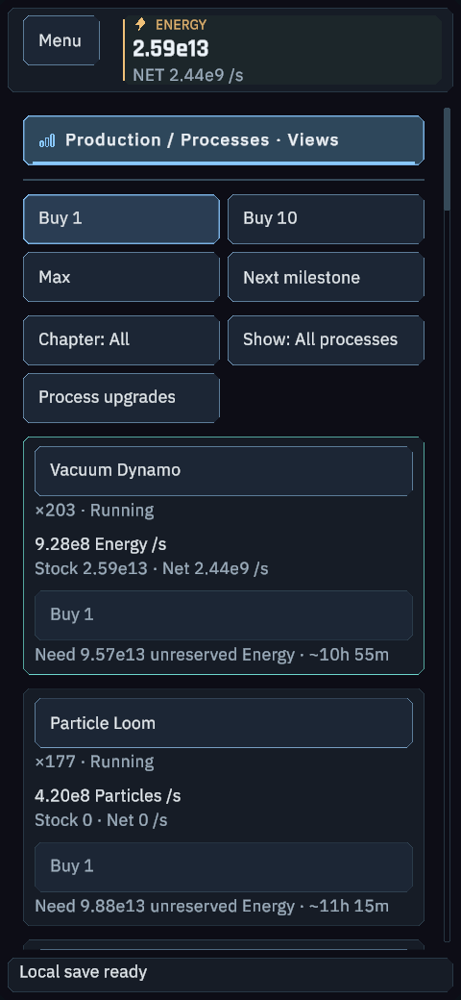
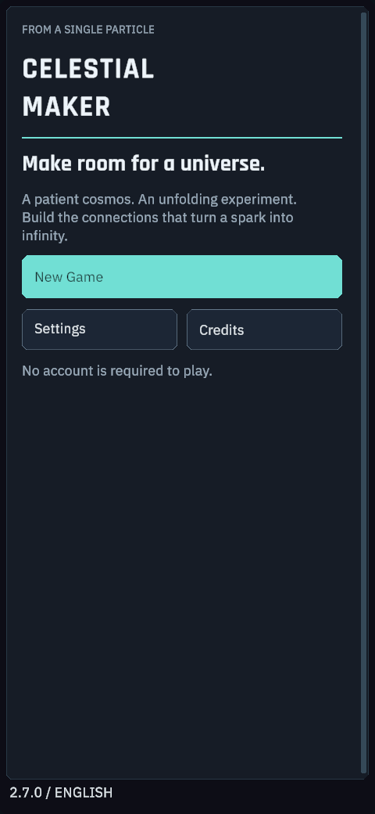

# Android 17 / One UI 9 preparation

Updated 2026-10-11. Intended device: Samsung Galaxy S26 Ultra.

**IMPLEMENTED:** the complete Observatory is enabled on Android, with compact touch navigation, 52-unit minimum button targets, density scaling based on the short screen dimension, safe-area anchors and rebuilds after rotation/inset changes. The narrow header opens all discovered resource balances on tap. Both portrait and landscape use the same full game screens, including Discovery. Fresh Android campaigns default to Mobile quality and a 60 FPS limit. This is a limit, not a measured phone frame rate.

**COMPILED / OBSERVED:** Unity 6000.6.3f1 compiled the changes for the Windows editor. 432/432 phone layout/target checks passed at 480x1040, 1040x480, 360x800 and 800x360 logical sizes, early/late state and 100/125% text. The existing desktop regression also passed 1479/1479. Sixteen actual uGUI/URP offscreen phone fixtures were rendered, with representative screens inspected. These do not emulate Android lifecycle, a soft keyboard, physical touch or the Samsung display.

**NOT BUILT:** no APK has been produced in this pass. The Android Unity module and OpenJDK exist, but SDK/NDK are absent. Earlier records explicitly deferred acceptance of Google's SDK terms. The user has now requested APK work; a specific question about SDK/NDK license acceptance is pending. No package was downloaded or license accepted while that answer is pending.

## Build configuration

The new `AndroidAPKSideload` profile uses ARM64 IL2CPP, Android target API 37, minimum API 26, Mobile quality, package `com.celestialmaker.game`, version 2.7.0/code 27001 and a single APK. It disables development-build instrumentation and uses Unity's development signing identity; production signing is not requested. Default backend configuration is empty. No Google Play account or billing setup is required for a local APK.

`Tools/setup-android-sdk.ps1` prepares project-local tools only after explicit license acceptance. It validates the official command-line archive's size and SHA-384, then uses sdkmanager's actual license prompts for the selected packages. It does not fabricate license hashes. Required tools: SDK platform 37, build-tools 36.0.0, NDK 27.2.12479018/r27c, CMake 3.22.1, platform-tools, CLI 16 and OpenJDK 17. The SDK installer script is prepared and parsed, but has not been executed.

After acceptance:

```powershell
./Tools/setup-android-sdk.ps1 -AcceptGoogleSdkLicense
./Tools/build-android.ps1 -Sideload
```

Planned output: `Builds/Android/CelestialMaker-2.7.0-Android-arm64.apk`.
This path is a target, not an existing deliverable.

## Remaining acceptance

1. Install the authorized SDK/NDK tools, compile the Android player and resolve Android-specific compiler/Gradle/IL2CPP errors if any.
2. Verify package name, SDK target, ARM64 ABI, installed permissions and signature from the produced APK.
3. Inspect native ELF load/RELRO alignment and APK zip alignment for 16 KB page-size compatibility.
4. Verify no payment SDK or production credentials are packaged.
5. Hash and copy the verified APK to the requested `Calestial Maker` desktop folder; publish it only with its accurate test status.
6. Physical installation, touch, keyboard, rotation, suspend/resume, offline catch-up, thermal behavior and FPS on the S26 Ultra remain unverified without the device. An offscreen fixture is not a device test.

## UI previews

Actual Unity UI rendered into a private RenderTexture from a synthetic late-campaign state. No desktop was captured.






## Reference material

- [Android 17 migration and compatibility testing](https://developer.android.com/about/versions/17/migration): compatibility testing remains necessary even when an application compiles; targeting the new API is a separate step.
- [Unity 6000.6 supported Android dependencies](https://docs.unity.com/en-us/engine/6000.6/manual/platform-specific/android/getting-started/sdksetup/supported-dependency-versions): the pinned editor uses NDK r27c and OpenJDK 17; its bundled SDK tool versions are documented here.
- [Android native 16 KB page-size checks](https://developer.android.com/guide/practices/page-sizes): inspect native alignment and validate the final APK with `zipalign -c -P 16 -v 4`.
- [Google Android SDK terms](https://developer.android.com/studio/terms).
