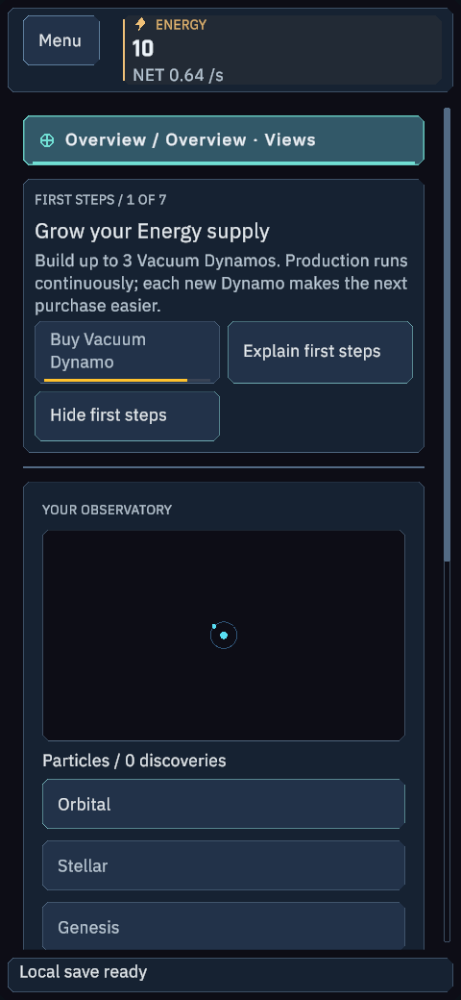
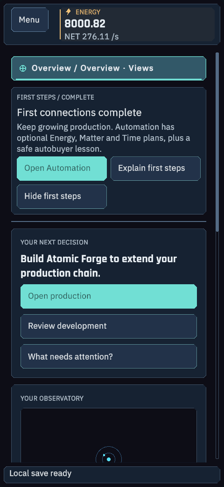
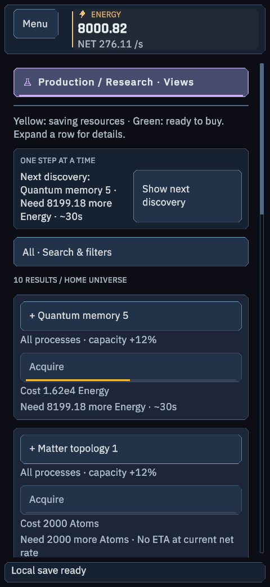

# Android 2.8.3 — S26 Ultra

English-only ARM64 sideload APK for Android 17 / One UI 9. [APK](https://github.com/Jakubix-pl/celestial-maker/releases/download/v2.8.3/CelestialMaker-2.8.3-Android-arm64.apk) · [SHA-256](https://github.com/Jakubix-pl/celestial-maker/releases/download/v2.8.3/CelestialMaker-2.8.3-Android-SHA256.txt).

**IMPLEMENTED:** complete game with adaptive First steps, genuine first-run supply buffer and purchased/maxed-last ordering. Continuous production, paid Prestige autobuyers, yellow/green funding bars, full offline tick replay, portrait/landscape layouts and safe areas. Existing saves retained.

**COMPILED / TESTED:** phone geometry/actions 464/464, Core 332/332, systems 63/63, APK 34/34. Unity 6000.6.3f1, JDK 17, NDK r27c, target/compile API 37, minimum 26, version code 28301. Native ARM64 ELF/ZIP 16 KB alignment checks pass. No billing permission.

**BUILT:** 40,867,295-byte non-debuggable APK, zero errors, Unity development signing for sideloading. Certificate matches the previous 2.8.2 package; launcher payload continuity is separately verified. No production signing.

**OBSERVED:** 36 private Unity phone-layout renders on the desktop GPU. Physical S26 Ultra installation, touch, rotation, lifecycle and FPS remain unverified. The 60 FPS default is a target/limit rather than measured device performance. No desktop input/capture or visible game launch.

Copy the APK to the phone and open it; allow installation from that selected file source when Android requests it. Keep an exported save. A matching signed installation can be updated without uninstalling. Do not uninstall a differently signed installation before preserving its save. Earlier versioned APKs remain available.

[Audit](../Release/FIRST-STEPS-2.8.3.md) · [APK checks](apk-verification.json) · [Phone checks](ui-checks-2.8.3.json) · [Renders](screenshots-2.8.3.json)
