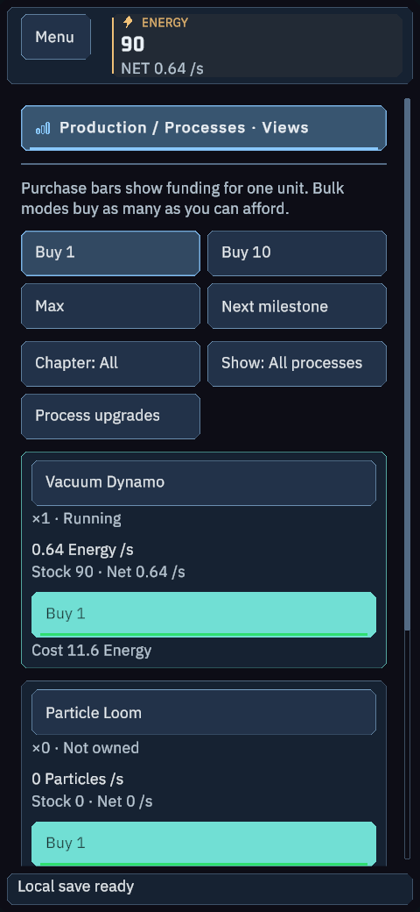
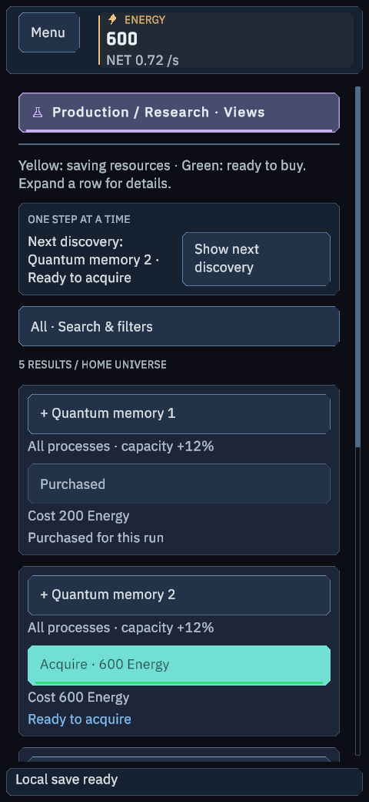

# Android 2.8.2 — S26 Ultra

English-only ARM64 sideload APK for Android 17 / One UI 9. [Download APK](https://github.com/Jakubix-pl/celestial-maker/releases/download/v2.8.2/CelestialMaker-2.8.2-Android-arm64.apk) · [SHA-256](https://github.com/Jakubix-pl/celestial-maker/releases/download/v2.8.2/CelestialMaker-2.8.2-Android-SHA256.txt).

**IMPLEMENTED:** complete 2.8.2 economy, corrected costs/targets, purchase bars and next-research guidance. Portrait/landscape Observatory, safe areas, 52-unit touch targets, 60 FPS default limit, Prestige-funded autobuyers and full offline replay. Old purchased IDs and saves are retained. [Change details](../Release/CASUAL-2.8.2.md).

**COMPILED / TESTED:** 452/452 phone UI fixture checks and 34/34 APK checks. Shared Core 318/318 and systems 63/63 also pass from clean source. Unity 6000.6.3f1, JDK 17, NDK r27c, target/compile API 37, minimum API 26, version code 28201. ARM64 native libraries meet the verifier's 16 KB ELF/ZIP checks. No billing permission.

**BUILT:** single APK, 40,856,911 bytes, zero build errors, non-debuggable. Unity development signing identity; physical installation remains unverified. The signing certificate matches the previous 2.8.1 APK, and all 178 Android PNG resources are unchanged. A matching previous installation can be updated without uninstalling. [Update compatibility](update-compatibility-2.8.2.json).

**OBSERVED:** 24 actual private Unity phone-layout renders, including new purchase states. These were rendered on the desktop GPU, not captured from a phone. Physical installation, touch, suspend/resume and FPS on the S26 Ultra remain unverified. No desktop input/capture or visible game was used.

To install: copy the APK to your phone, open it, and allow installation from that chosen file source when Android requests it. Keep an exported save before updating. If Android reports a signature mismatch with a differently signed installation, do not uninstall blindly; preserve/export that save first. Earlier versioned artifacts remain available.

[Package verification](apk-verification.json) · [UI checks](ui-checks-2.8.2.json) · [Screenshots](screenshots-2.8.2.json) · [Release validation](../Release/VALIDATION.md).
