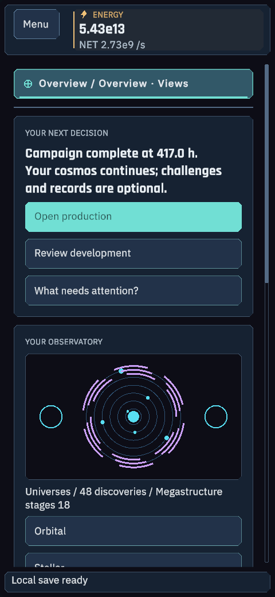
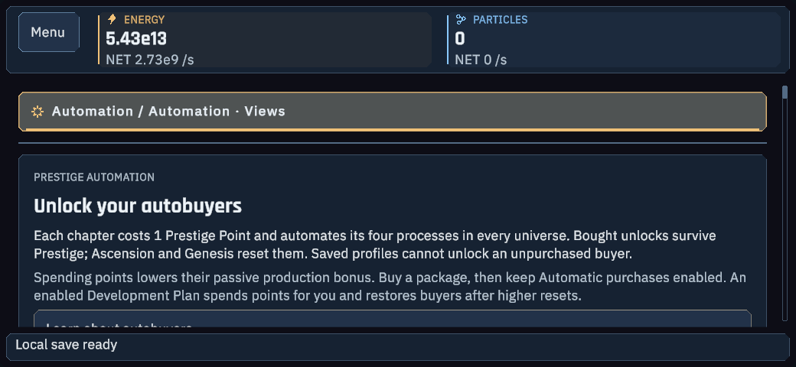

# Android 2.8.1 — S26 Ultra build

Prepared 2026-10-11 for Samsung Galaxy S26 Ultra with Android 17 / One UI 9. English only. The APK is built and package-validated; installation, touch, lifecycle and FPS on that physical device remain unverified.

[Download APK](https://github.com/Jakubix-pl/celestial-maker/releases/download/v2.8.1/CelestialMaker-2.8.1-Android-arm64.apk) · [SHA-256](https://github.com/Jakubix-pl/celestial-maker/releases/download/v2.8.1/CelestialMaker-2.8.1-Android-SHA256.txt)

## IMPLEMENTED

Complete 2.8.1 economy and Observatory, including around-400-hour pacing, paid chapter buyers and safe five-step practice. Portrait/landscape touch navigation, 52-unit targets, short-side density scaling, safe-area anchors and resource drawer. Fresh Android campaigns use Mobile quality and a 60 FPS cap. Suspend/resume uses the existing save/offline simulation; the OS may suspend the application, so production catches up on return.

Adaptive icons now explicitly use the game's emblem, a dark background and padded foreground through Unity Editor APIs. Unity retained a default legacy bitmap despite the legacy icon API assignment, so an Editor Gradle callback replaces that generated fallback resource with the emblem at its original dimensions. Both extracted variants were inspected before delivery. No Windows artifacts were replaced.

## COMPILED / TESTED

- Unity 6000.6.3f1 compiled the Android target and ARM64 IL2CPP player.
- **448/448** phone layout/callback checks: early/late states, portrait/landscape, 360–1040 logical dimensions, 100/125% text, dialogs, navigation, touch targets and the new autobuyer guide.
- **34/34** APK checks: identifier/version, min/target SDK, ARM64, non-debuggable manifest, v2 signature, CRCs, 16 KB ZIP alignment, all 6 AArch64 ELF libraries and launcher resources.
- **19/19** protected local baseline files unchanged.

The shared Core/runtime sources are unchanged from the tested Windows 2.8.1 release (297 Core and 63 system checks). Those earlier results are not physical Android gameplay evidence.

## BUILT

`CelestialMaker-2.8.1-Android-arm64.apk`, **40.85 MB**, zero Unity build errors. Package `com.celestialmaker.game`, version 2.8.1/code 28101, ARM64 only, minimum API 26, target/compile API 37. One installable APK; no split files or OBB.

Signed with Unity's development signing identity for local sideloading, not a production/store key. Development instrumentation is disabled. Update packages must retain the same identifier and signing certificate. The signing key is not published. [Artifact hashes](artifacts-2.8.1.json), [build evidence](build-2.8.1.json), [APK checks](apk-verification.json).

The native libraries are compressed in the APK and extracted by Android (`extractNativeLibs=true`); every ELF LOAD segment passes 16 KB alignment. `zipalign -c -P 16 -v 4` also succeeds. These are static compatibility checks, not a device boot test.

Permissions: `android.permission.INTERNET` and the package-local AndroidX receiver permission. No billing, camera, microphone, contacts, location or broad-storage permission. Default backend URL is empty. No account or payment is needed.

## OBSERVED / NOT OBSERVED

Twenty real Unity uGUI/URP phone-layout images were rendered privately, including both guide orientations. Representative Overview, Automation, guide start/completion and extracted launcher images were inspected. The renderer is a desktop GPU using phone logical dimensions; it does not emulate a Samsung device. [Capture manifest](screenshots-2.8.1.json).

No desktop control/capture, visible Unity/game window, emulator or physical phone run. Physical install, keyboard, touch, back gesture, cutout/insets, rotation, suspend/resume, offline catch-up, thermal behavior and FPS on S26 Ultra are **UNVERIFIED**. No store review or production signing is claimed.

## Install

Transfer/download the APK to the phone, open it and allow installation from that source if Android requests it. This is a sideload build, not a Google Play release. The phone uses its own save folder; existing PC progress can be transferred through the game's JSON export/import. Device import and update behavior still require a physical test.

## Rebuild

Google SDK terms were explicitly accepted by the user in this task. Dependencies are local and ignored by Git: CLI 16, platform 37.0 revision 2, build tools 36.0.0, platform tools 37.0.1, NDK r27c, CMake 3.22.1 and JDK 17.0.18. The SDK package name was corrected from `platforms;android-37` to `platforms;android-37.0` based on Google's package inventory.

```powershell
./Tools/setup-android-sdk.ps1 -AcceptGoogleSdkLicense
./Tools/build-android.ps1 -Sideload
python Tools/verify-android-apk.py --apk Builds/Android/CelestialMaker-2.8.1-Android-arm64.apk --sdk Tools/AndroidSetup/SDK --jdk Tools/AndroidSetup/OpenJDK --output Logs/AndroidVerification
```

The license switch requires the operator's own acceptance. Use the pinned editor; do not close an unrelated editor if the project is locked. Verification never installs or launches an app.

## Screens





## References

- [Android 17 compatibility](https://developer.android.com/about/versions/17/migration): compilation and targeting do not replace device testing.
- [Unity 6000.6 dependencies](https://docs.unity.com/en-us/engine/6000.6/manual/platform-specific/android/getting-started/sdksetup/supported-dependency-versions): NDK r27c and JDK 17.
- [Android 16 KB checks](https://developer.android.com/guide/practices/page-sizes): native ELF and ZIP alignment.
- [Unity platform icon API](https://docs.unity.com/en-us/engine/6000.6/script-reference/unityeditor/android/androidplatformiconkind).
- [Google SDK terms](https://developer.android.com/studio/terms).
