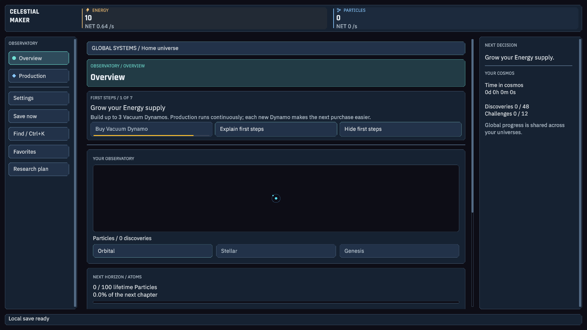
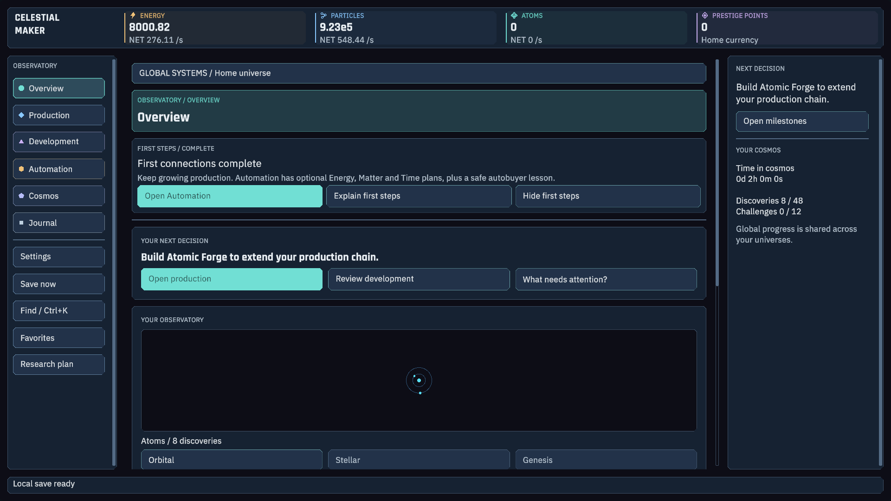
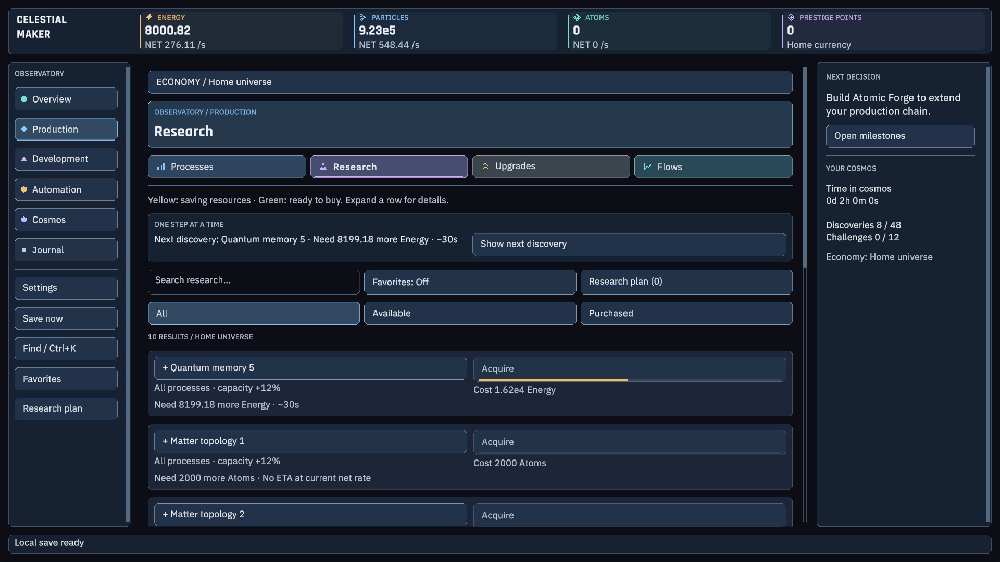
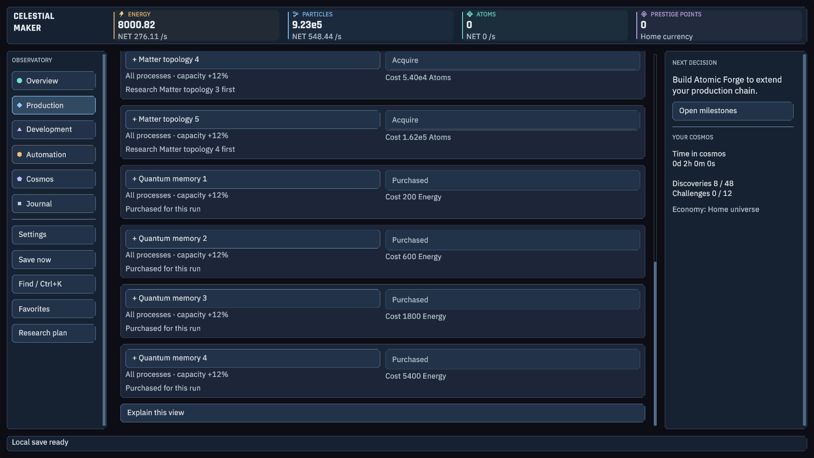

# First two hours — 2.8.3

The old static tip sent players from a Particle Loom to a Matter Condenser without an Atomic Forge. The condenser therefore had no incoming Matter. Its scripted two-hour audit never reached Prestige and contained a 78-minute interval without a manual purchase. Buying a consuming process could also leave too little Energy for the next decision.

## Implemented changes

- An optional First steps card reads real purchases: three Vacuum Dynamos, a Particle Loom, a Zero-point Array, Quantum memory 1, then Energy growth. It compares useful Energy capacity per cost and clearly labels bulk buying as Buy Max.
- A genuinely fresh home run retains at least 20% of incoming purchase resources while consumers keep running. All retained resources are actual production; no currency or points are injected. This starter buffer ends at first Prestige and does not reactivate on historical saves, challenges or scenarios.
- The guide opens a Prestige review; it never silently resets. After the player's confirmation it explains the paid 1-PP autobuyer. Hide/reopen uses the existing tutorial preference; progress follows the save rather than a new persisted tutorial cursor.
- The explanation shows the later dependency chain: Particle Loom → Atomic Forge → Matter Condenser. Input availability still matters.
- Purchased research/upgrades, buyers and acquired development items move behind pending items. Fully completed projects/challenges and truly capped processes move to the end. Ascension items retain their branch columns and sort within them. A production milestone such as 100 is not a cap. Tutorial and Next decision use the same recommendation, with the duplicate action card hidden during first steps. Automatic purchases refresh the list without currency-driven reshuffling; scroll position is retained.

Existing purchased IDs, saves, chapter prices and long-term construction curves are retained. The corrected costs and yellow/green purchase bars from 2.8.2 remain.

## Measured first two hours

Five fresh profiles use the actual Core at 60 ticks/second for two hours. Guided profiles follow the displayed suggestions, with at most eight manual actions per five- or fifteen-minute visit. They confirm the first reset and buy the first package with its earned point. After that automatic buying continues; absence of further manual clicks is not a production stall.

| Profile | First research | First Prestige | Longest manual purchase interval before Prestige |
| --- | --- | --- | --- |
| Guided, every 5 minutes | 10.0 min | 35.0 min | 5.0 min |
| Guided, every 15 minutes | 15.0 min | 60.0 min | 15.0 min |
| Broad purchases, every 5 minutes | 10.0 min | 40.0 min | 5.0 min |
| Broad purchases, every 15 minutes | 30.0 min | 75.0 min | 15.0 min |

Keeping the obsolete static purchase sequence still fails to reach Prestige: supply protection alone cannot repair a missing upstream building. That control profile remains in the report rather than being presented as successful. These are scripted policies, not observed human onboarding or a promise for every player.

[Raw audit](onboarding-2.8.3.json) · [Release validation](VALIDATION.md)

Images are actual private Unity renders from a fresh save and a literal two-hour guided simulation, not desktop screenshots.
