

# Celestial Maker

**Make room for a universe.**

A patient cosmos. An unfolding experiment. Build production chains, automate your next six hours, and turn a single spark into a network of universes.

**Windows x64 / Android ARM64 · English · Single player · Free to play · No account required**

[Download the installer](https://github.com/Jakubix-pl/celestial-maker/releases/download/v2.8.3/CelestialMaker-Setup-2.8.3.exe) · [Portable ZIP](https://github.com/Jakubix-pl/celestial-maker/releases/download/v2.8.3/CelestialMaker-Observatory-Windows.zip) · [Release notes](Docs/Release/RELEASE-NOTES.md) · [Build from source](Docs/BUILDING.md) · [Android APK](https://github.com/Jakubix-pl/celestial-maker/releases/download/v2.8.3/CelestialMaker-2.8.3-Android-arm64.apk)

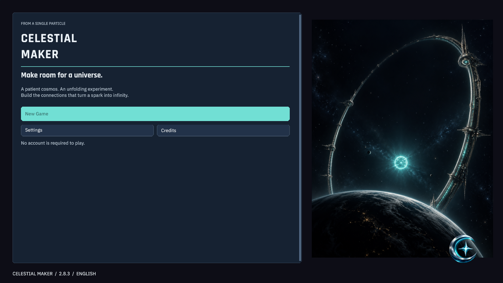

## Build an economy that keeps working

Start with Energy. Connect production, research and upgrades, then decide what to spend, what to reserve, and when to begin again. **Prestige → Ascension → Genesis** opens three layers of development, with explicit previews of what each reset keeps and removes.

Your choices continue between visits. Offline progress replays the shared simulation at **60 ticks per second**, including unlocked automation, construction, expeditions and transfers. Absence has no duration cap; long absences take processing time and the remaining replay is resumable.

## Shape your cosmos

| System | Your decisions |
| --- | --- |
| Production and research | Follow input bottlenecks, protect reserves, queue research and compare growth paths. |
| Three megastructures | Build six stages and choose engineering modules with benefits and costs. |
| Nine reality laws | Change the rules of your economy as your strategy develops. |
| Parallel universes | Specialize satellite economies and connect them through scheduled transfers. |
| Goal-based automation | Complete an ordered goal, protect its resources, and hold automatic resets until ready. |
| Six-hour laboratory | Compare two plans on isolated copies of your state before committing. |
| Twelve challenges | Adapt to different constraints, run readiness trials and review why an attempt stalled. |
| Expedition discoveries | Resolve signals into permanent route choices; discoveries wait for you. |
| Practice and chronicle | Revisit safe lessons, including the five-step autobuyer introduction, review your decisions, then try optional scenarios in separate saves. |

There is no shop, checkout or paid production boost. Cosmetics are earned in the game.

## First steps

An optional guide follows your actual purchases, from a few Energy producers to your first reviewed Prestige and paid autobuyer. Consumers leave a starter supply buffer during the first run; production keeps running. Purchased and truly maxed items move behind pending choices.

Guided simulations reach the first Prestige in **35 minutes with five-minute visits** or **60 minutes with fifteen-minute visits**. These are measured scripted policies, not a guaranteed player time. [The two-hour audit and changes](Docs/Release/FIRST-STEPS-2.8.3.md).

## Purchases at a glance

Research prices rise clearly from 200 to 600, 1,800, 5,400 and 16,200 Energy. Process upgrades strengthen their own chapter. Thin bars fill yellow while you save and turn green when you can buy; prerequisites and reserves still matter. Research offers one next-discovery suggestion, while optional details and strategic systems remain available.

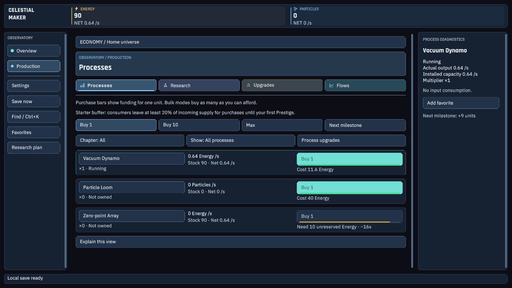
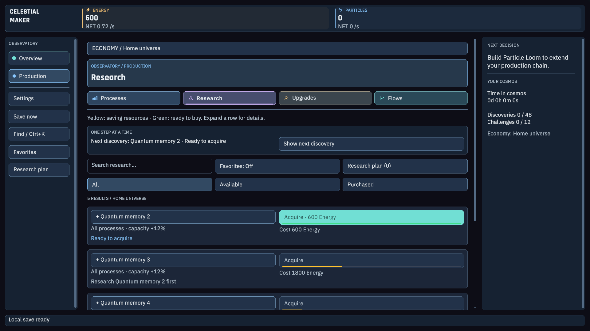

[Cost changes in 2.8.2](Docs/Release/CASUAL-2.8.2.md).

## The Observatory

An interface built around readable numbers and clear decisions: category colors and icons, compact expandable rows, contextual explanations, search, favorites, adjustable text, two themes and reduced motion. Advanced currencies and locked navigation appear as you unlock them. Buildings emerge when their requirements are within a 30-second forecast; the first reset reveals every building. Overview has animated orbital bodies and megastructure arcs, with Reduced Motion available.

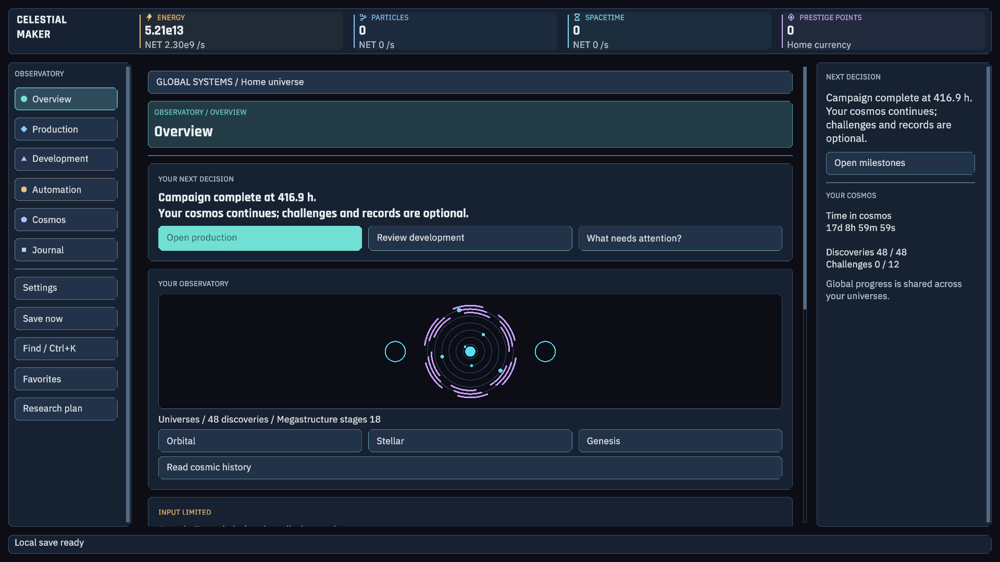

**Plan the next visit.** Keep a simple Energy, Matter or Time development plan, or use more specific goals and reserves.

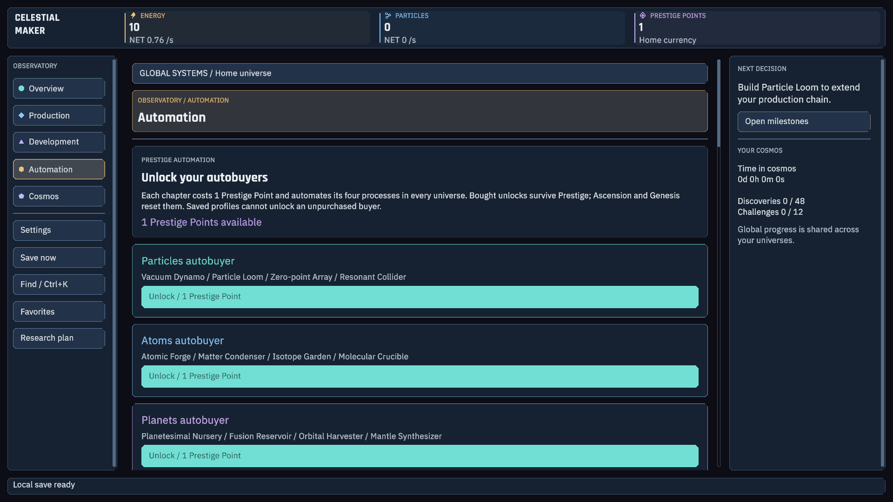

Each chapter autobuyer costs **1 Prestige Point** and covers four processes. Unlocks survive Prestige; Ascension and Genesis clear them. Production runs continuously, subject to inputs and reserves. Old saves keep their progress but must purchase the new buyer unlocks. A lower first/recovery Prestige threshold helps earn the point needed to restore automation.

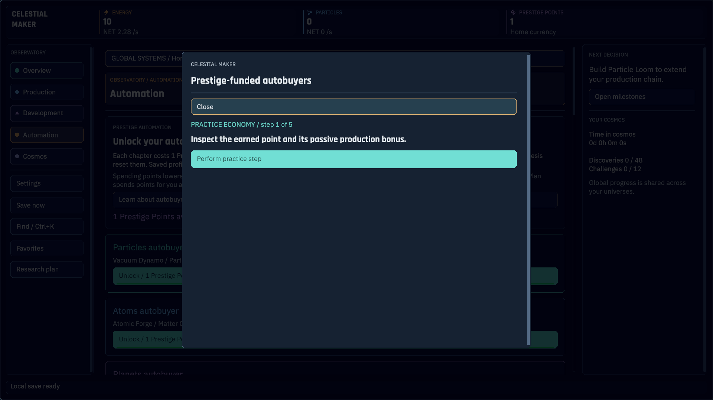

Learn point spending, automatic buying and reset retention in five safe practice steps; your campaign is unchanged.

**Make engineering tradeoffs.** Tune megastructures for production or transport and see each choice's cost.

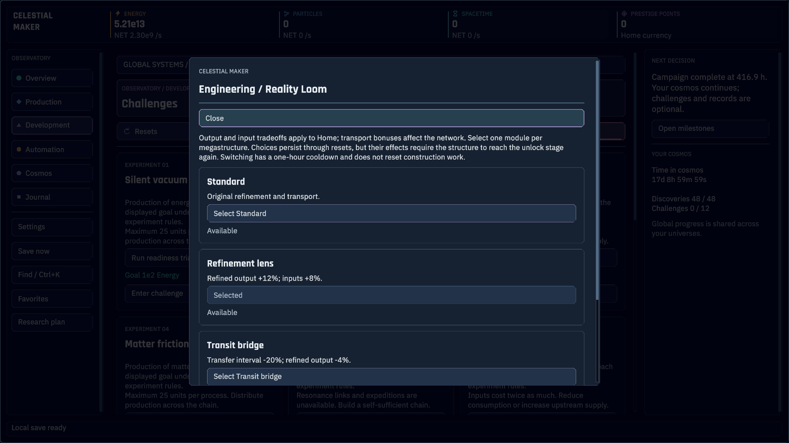

More screens: production, research, universes, challenges and Dawn theme

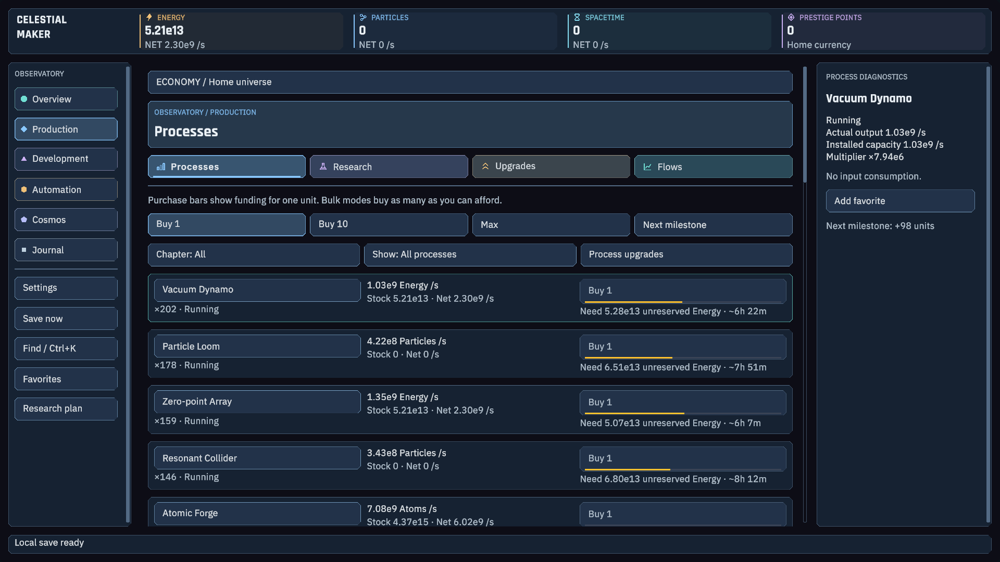
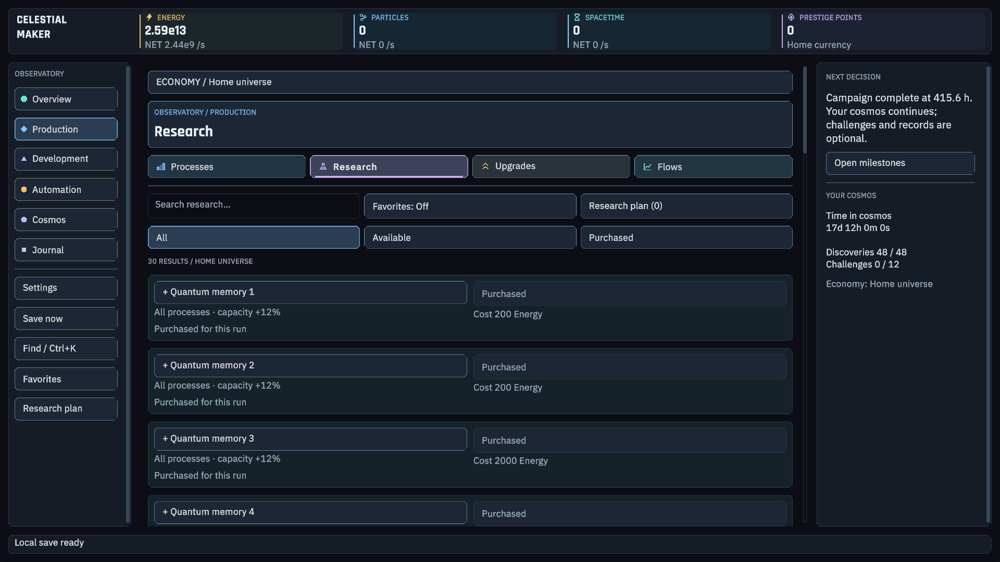
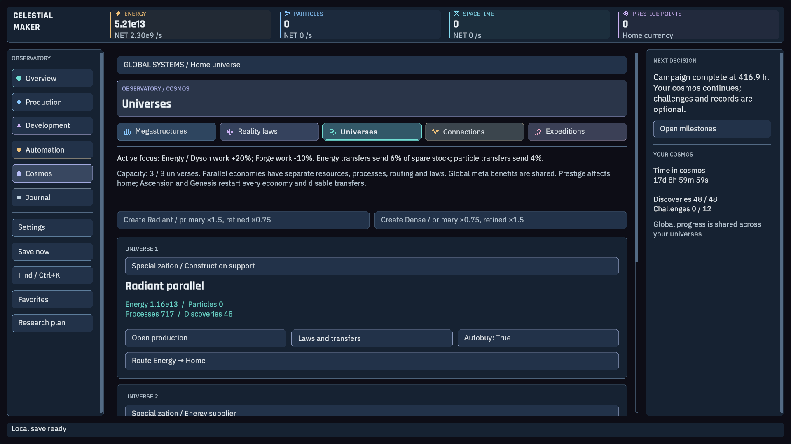
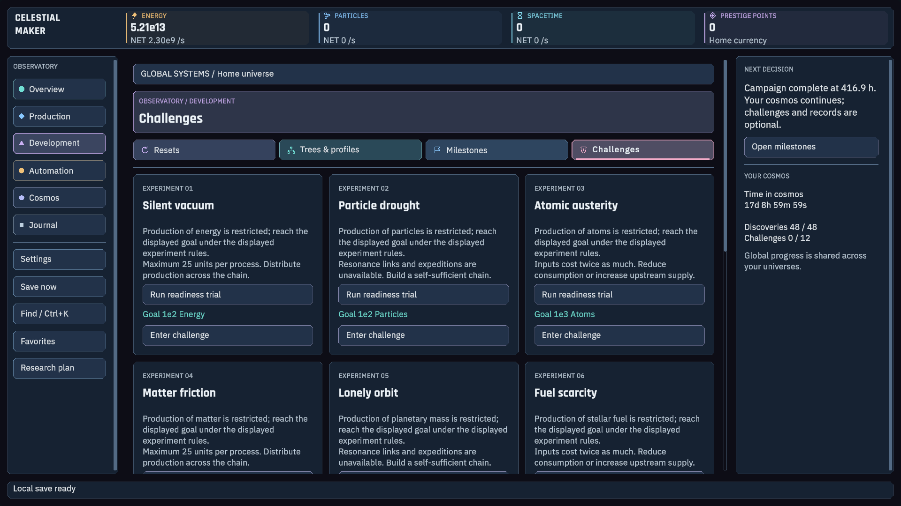
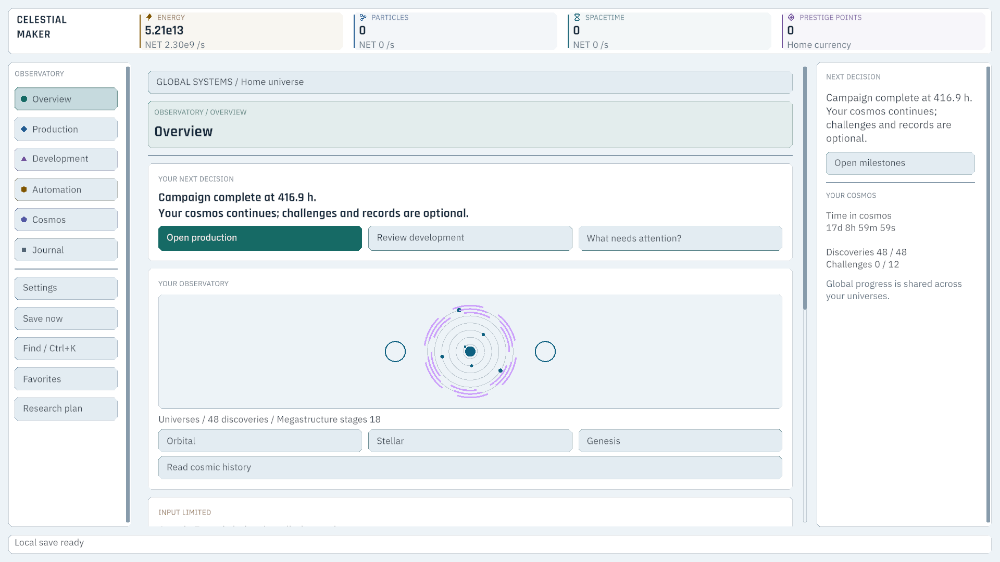

These images show the actual 2.8.3 Unity interface, rendered offscreen from fresh first steps, a real two-hour guided run, purchase examples and a simulated late-campaign state. The late-game fixture is a completed 2.8.3 simulated Energy campaign; its displayed time belongs to the event-stepped policy. Literal offline measurements are separate. Late-game screens contain progression spoilers. [Capture method and manifest](Docs/Release/screenshots.json).

## Play at your pace

The campaign targets roughly **400 hours of elapsed progression**, with active play, background play or offline simulation. It does not require 400 hours of clicking.

Three measured policies that revisit the game every six hours completed the campaign in **395.2–416.9 hours** with every offline tick replayed. Nine additional active/background/check-in simulations completed in **370.6–416.9 hours**. All tested policies fall within the 360–440-hour target band. These are simulation results using the game's real tick engine, not a guarantee for every player. The Development Plan is optional; the first reset of each type requires your confirmation. Choices, strategy and automation affect the pace.

## Install and start

1. Download **CelestialMaker-Setup-2.8.3.exe** from [Releases](https://github.com/Jakubix-pl/celestial-maker/releases/latest), or extract the entire portable ZIP.
2. Install for your Windows user, or run **CelestialMaker.exe** in the extracted folder. Keep its data folder alongside it.
3. Choose **New Game**. Existing supported saves are migrated when loaded; a new game is not required for an upgrade.

The installer offers a desktop shortcut with the game's icon. It does not launch the game automatically. Uninstalling preserves player saves. Local profiles and export/import work without an account or backend. The current installer is unsigned; published [SHA-256 checksums](https://github.com/Jakubix-pl/celestial-maker/releases/download/v2.8.3/CelestialMaker-2.8.3-SHA256.txt) identify these exact files.

## Android build

An English ARM64 APK is available for Android 17 / One UI 9, intended for S26 Ultra. Portrait and landscape touch layouts share the complete 2.8.3 game. Package checks passed; physical device installation, touch, lifecycle and FPS remain unverified. The APK uses development signing for sideloading, not a store release. [Android evidence and installation](Docs/Android/STATUS.md).

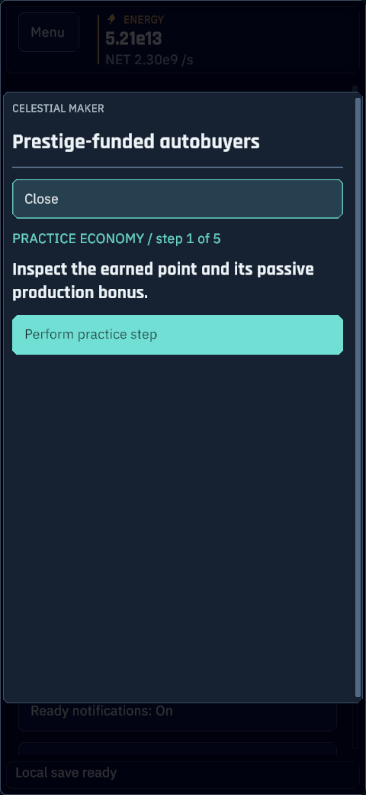

## Release verification

The release has a built Windows player, automated core/UI checks, installed-player tests, silent installation/upgrade/removal checks, and measured campaigns. The portable source suite contains **332 checks** and the extended system audit contains **63 checks**. A GitHub Actions template is included in `Tools/CI/github-core.yml`; these tests were verified locally from a clean source copy. Hosted CI is not active because the publication credential cannot write workflow files.

The late-game offscreen benchmark covered **22 cases and 5,280 measured frames**, including 4K, large text, dialogs and forced automation decision boundaries. This run on the RTX 4070 Ti / Ryzen 7 9800X3D had 1 samples above 16.67 ms. It separates UI work, render submission and synchronous GPU readback. **This is an offscreen workload measurement, not a verified desktop or phone FPS claim.** Human playtesting, physical device behavior, Windows DPI and a clean-machine install remain open acceptance checks.

[Detailed validation and limitations](Docs/Release/VALIDATION.md) · [Measured performance data](Docs/Release/performance.json) · [2.8.3 implementation](Docs/Release/FIRST-STEPS-2.8.3.md)

## Explore the source

| Directory | Contents |
| --- | --- |
| `Game` | Unity 6000.6.3f1 project, runtime, UI, assets and editor tests. |
| `Tools` | Shared-core simulator, regression checks, build and packaging scripts. |
| `Docs` | Design history, measurements, release documentation and gallery. |
| `Design` | Design artifacts. |
| `Website`, `Backend` | Optional local web/account experiments; not required by the Windows game and not deployed by this release. |

Unity is only opened against `Game`. Generated libraries, builds, logs, credentials, compiler downloads and personal save backups are excluded from the repository. Committed fixtures are synthetic simulator outputs. [Build instructions](Docs/BUILDING.md) explain the portable tests and Windows packaging.

Third-party notices are retained in [Licenses and provenance](Docs/LICENSES.md). The repository does not currently grant an additional project-wide open-source license.

Found a problem? [Open an issue](https://github.com/Jakubix-pl/celestial-maker/issues) with your game version, steps to reproduce, expected result and the relevant screen. Avoid posting personal information or account credentials.
